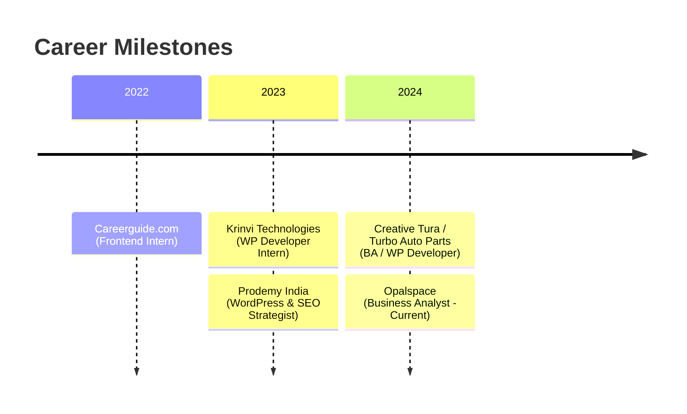

# Nikhil Singh
### **Business Analyst • Product & Operations Analyst • Software Developer • Entrepreneur**

  <em>Bridging the gap between business objectives, complex user journeys, and robust engineering architecture.</em>

---

## 📌 Executive Summary

I am a **Business Analyst and Product Builder** with 4 years of experience spanning requirement engineering, digital product delivery, operational workflow optimization, cross-functional vendor management, and modern web architectures.

* **Strategic Execution**: Proven track record in translating ambiguous business challenges into actionable Functional Requirement Documents (FRD), Business Requirement Documents (BRD), User Stories, and Acceptance Criteria.
* **Measurable Growth**: Spearheaded digital strategy and technical SEO at Creative Tura for Turbo Auto Parts, accelerating organic search traffic from **~1,570 to 17,700 monthly sessions in just 4 months** (**+1,027% organic growth**).
* **Technical Breadth**: Hands-on familiarity with modern tech stacks, including **Python**, **Dart/Flutter**, **PHP/MySQL**, **WordPress/WooCommerce**, **REST APIs**, **Cloud/Hosting (AWS, cPanel)**, and automated workflows.
* **Product Entrepreneurship**: Founder and builder of independent tech ventures including **ScanSecure** (smart QR emergency medical card), **QuickChat** (decentralized offline BLE mesh messenger), and **SpillX** (anonymous social sharing).

---

## 🛠️ Core Competencies

<table>
  <tr>
    <td width="50%" valign="top">
      <h3>📊 Business Analysis & Product Strategy</h3>
      <ul>
        <li><strong>Requirements Engineering:</strong> BRD, FRD, User Stories, Acceptance Criteria, Scope Definition</li>
        <li><strong>Traceability & QA:</strong> Requirements Traceability Matrix (RTM), Gap Analysis, UAT Test Cases, Change Request Logs</li>
        <li><strong>Process Modeling:</strong> As-Is / To-Be Workflows, BPMN / Process Flows, System Wireframes, UI Specifications</li>
        <li><strong>Methodologies:</strong> Agile/Scrum, SDLC, Sprint Planning, Backlog Prioritization, Go-Live Sign-offs</li>
      </ul>
    </td>
    <td width="50%" valign="top">
      <h3>⚙️ Operations, CRM & Delivery</h3>
      <ul>
        <li><strong>CRM Administration:</strong> Perfex CRM custom modules, workflows, lead management & relational database structures</li>
        <li><strong>Vendor & Team Coordination:</strong> Managing engineering dependencies, unblocking blockers, cross-functional SLA adherence</li>
        <li><strong>Root Cause Analysis:</strong> Diagnosing workflow bottlenecks and technical edge cases for operational integrity</li>
        <li><strong>Documentation:</strong> Standard Operating Procedures (SOPs), technical handoffs, project charters</li>
      </ul>
    </td>
  </tr>
  <tr>
    <td width="50%" valign="top">
      <h3>💻 Software Development & Web Engineering</h3>
      <ul>
        <li><strong>Languages & Frameworks:</strong> Python, Dart / Flutter, JavaScript (ES6+), PHP, HTML5, CSS3, Bootstrap</li>
        <li><strong>CMS & Web Systems:</strong> WordPress Custom Development, WooCommerce Architecture, CodeIgniter</li>
        <li><strong>Databases & APIs:</strong> MySQL, Database Relational Design, RESTful API Integration, Webhooks</li>
        <li><strong>Decentralized & Mobile:</strong> Bluetooth Low Energy (BLE) Mesh Networks, Offline P2P Relaying, IndexedDB</li>
      </ul>
    </td>
    <td width="50%" valign="top">
      <h3>📈 Data, Reporting & Digital Growth</h3>
      <ul>
        <li><strong>Analytics & BI:</strong> Microsoft Excel (Advanced), Power BI, KPI Dashboarding, Data Analysis</li>
        <li><strong>Search Engine Optimization:</strong> Technical SEO, On-Page Architecture, Schema Markup, Core Web Vitals, Content Gap Analysis</li>
        <li><strong>Growth Tooling:</strong> SEMrush, Ahrefs, Google Search Console, Google Analytics (GA4), Meta Ads, Google Ads</li>
        <li><strong>Infrastructure:</strong> Git, GitHub, AWS, cPanel, GoDaddy, Hostinger, SSL, DNS & Website Migration</li>
      </ul>
    </td>
  </tr>
</table>

---

## 🚀 Products & Featured Engineering Projects

### 1. [ScanSecure](https://scansecure.in) — *Founder & Lead Architect*
> **Emergency Smart-Card Platform (QR-Enabled PVC Tech)**  
* **Problem Solved**: Enables first responders or bystanders to instantly access vital emergency medical data and primary emergency contacts without requiring the patient's phone to be unlocked, an app installed, or user login.
* **Capabilities**: Defined end-to-end user journeys for individual, student, and corporate safety cards. Configured dynamic user profile workflows, physical QR pairing protocols, and merchant partner collaterals.

### 2. [QuickChat](https://github.com/Cyconik/QuickChat) — *Developer*
> **100% Offline Bluetooth Mesh Group Messenger for Android**  
* **Architecture**: Zero Internet, Zero Cellular Data, Zero SIM Cards. Implements autonomous **Multi-Hop BLE Phone-to-Phone packet relaying** (`Phone A ➔ Phone B ➔ Phone C ➔ Phone D`).
* **Highlights**: Persistent broadcast channels (`#Nearby-Public-Mesh`, `#Trek-Emergency-SOS`), real-time unread alerts, audio chimes/haptics, admin moderation controls, and local persistent storage.
* **Direct Download**: [QuickChat-Mesh-Offline.apk](https://github.com/Cyconik/QuickChat/raw/main/QuickChat-Mesh-Offline.apk)

### 3. [Job Auto Apply Engine](https://github.com/Cyconik/job-auto-apply) — *Developer*
> **Automated Multi-Platform Application Bot & Screening Engine**  
* **Stack**: Python, Streamlit, Selenium WebDriver, pdfplumber, PyMuPDF, python-docx, pandas.
* **Features**: Automates application workflows across LinkedIn Easy Apply, Indeed, Remotive, and Naukri. Features automated resume parsing, semantic match-score evaluation against job descriptions, full screenshot audit logging for proof-of-submission, and automated HTML email digests with CSV/Excel exports.

### 4. [SpillX](https://spillx.in) — *Founder*
> **Anonymous Social Confession & Discussion Community**  
* **Highlights**: Engineered WordPress-backed platform with anonymous text confession feeds, interactive emotional reactions, private 1-on-1 conversations, safety moderation pipelines, and targeted SEO strategy.

### 5. [Galigram](https://galigram.com) — *Product Builder*
> **Location-Aware Hyper-Local Social Information Platform**  
* **Vision**: Concise 30-second video reporting, hyper-local discovery, community updates, and neighborhood conversation streams. (Global release scheduled for Jan 2027).

### 6. WebPConverter.tech & Custom Ecosystem Tools
* **WebPConverter.tech**: High-performance browser-based batch image converter and compression suite with client-side WebAssembly rendering, standalone REST API, and WordPress/WooCommerce plugin integration.
* **CyberZip Bulk Mailer**: Operational bulk outreach engine built for scheduled corporate outreach and delivery tracking.
* **Leads Scraper**: Automated target-based lead collection pipeline extracting verified B2B prospect intelligence.
* **Custom WordPress Plugins**: Developed custom WooCommerce product-bargaining bidding plugin, automated SEO blog publishing tool, and asset compression utilities.

---

## 💼 Professional Experience

### **Business Analyst** | **Opalspace**
*Dec 2024 – Present | Noida, Uttar Pradesh*
* Collaborate with internal leadership and operational heads to identify operational pain points, formalize business scope, and articulate functional delivery priorities.
* Coordinate with external technology vendors and cross-functional development teams, tracking milestone dependencies, resolving delivery bottlenecks, and upholding delivery SLAs.
* Supervise, customize, and maintain **Perfex CRM** modules, custom fields, automated email/lead workflows, and relational database schemas to streamline end-to-end sales and customer lifecycles.
* Conduct continuous root cause analysis on production workflow snags; engineer process optimizations that improve record fidelity and data reliability.
* Bridge functional requirements and technical execution by creating comprehensive requirement documents, process flowcharts, and technical notes for engineering teams.
* Build actionable reporting pipelines in Excel and Power BI, translating operational data into high-level KPI dashboards for executive decision-makers.

### **Business Analyst / WordPress Developer** | **Creative Tura Pvt. Ltd.** *(Client: Turbo Auto Parts)*
*Jul 2024 – Nov 2024*
* Spearheaded digital growth and technical SEO strategy, scaling organic traffic from **1,570 to 17,700 monthly sessions in 4 months** (**+1,027% organic traffic growth**).
* Authored end-to-end BA project artifacts: Project Charter, Stakeholder Register, BRD, FRD, User Stories, Acceptance Criteria, RTM, Process Flowcharts, UI Wireframes, UAT Scenarios, and Go-Live Sign-offs.
* Conducted requirement gathering and functional specification for an automated bidding platform for used automotive engines and transmissions, coordinating closely with developers on database schemas and API integrations.
* Configured WordPress/WooCommerce architectures, customized schema markup, executed Core Web Vitals optimization, and managed digital conversion funnels.

### **WordPress Developer & SEO Strategist** | **Prodemy India Pvt. Ltd.**
*Oct 2023 – May 2024*
* Delivered enterprise WordPress websites and search optimization solutions for clients across **8+ industries** (Healthcare, Logistics, E-commerce, Education, Fitness, Pet Care, Travel).
* Implemented mobile-first responsive interfaces, technical SEO audits, site speed caching layers, structured schema, and metadata architecture.
* Transformed client commercial goals into concrete engineering sprints, conversion-oriented landing pages, and measurable SERP rank improvements.

### **WordPress Developer Intern** | **Krinvi Technologies Pvt. Ltd.**
*Apr 2023 – Sep 2023*
* Developed and optimized client websites in construction, finance, and e-commerce domains.
* Managed Amazon and Flipkart catalog feeds, optimizing product titles, keyword tags, and inventory synchronization.
* **Received an official Appreciation Letter within 2 months** in recognition of superior execution speed and project ownership.

### **Frontend Developer Intern** | **Careerguide.com**
*Nov 2022 – Apr 2023*
* Engineered responsive UI components using HTML5, CSS3, and JavaScript (ES6).
* Performed deep keyword discovery and competitive gap analysis using SEMrush and Search Console, achieving **Top-3 Google organic rankings** for multiple core informational assets.

---

## 🎓 Education

* **Bachelor of Technology (B.Tech) — Computer Science and Engineering**  
  *Dr. APJ Abdul Kalam Technical University (AKTU), Lucknow* | *2022 – 2025* | **CGPA: 7.03**
* **Diploma — Aircraft Maintenance Engineering**  
  *Board of Technical Education, Uttar Pradesh (BTEUP)* | *2018 – 2021* | **Score: 80%**

---

## 🏆 Honors & Recognitions

* 🏅 **Mahindra All India Talent Scholarship** — Awarded on the basis of academic excellence and technical potential.
* 📜 **Appreciation Letter — Krinvi Technologies** — Awarded within 60 days of tenure for exemplary technical contributions.

---

## 📬 Connect & Contact

* **GitHub**: [@Cyconik](https://github.com/Cyconik)
* **Phone**: [+91 6388693276](tel:+916388693276)
* **Location**: Noida, Uttar Pradesh, India
* **Portfolio**: [Nikhil Singh Portfolio](https://github.com/Cyconik)

  Designed & Maintained with precision by Nikhil Singh (@Cyconik). All rights reserved.

